# 遥操练习场 Teleop Dojo

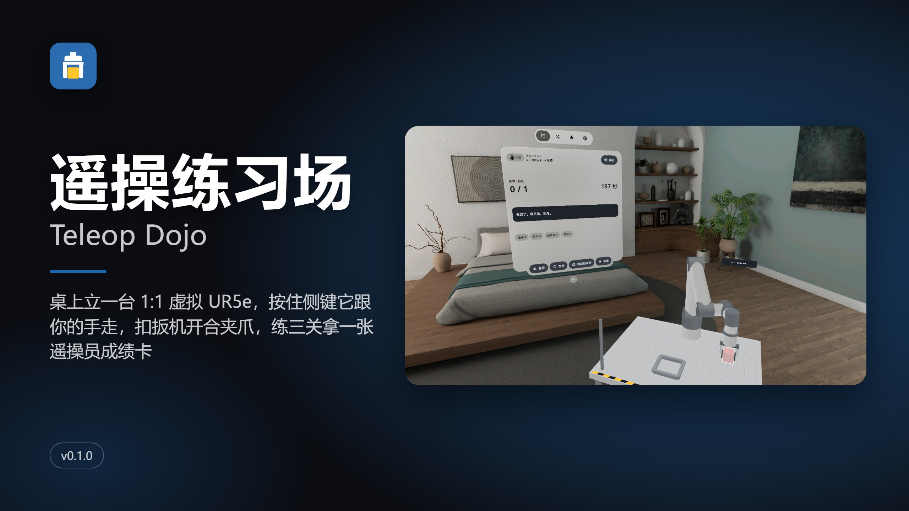

[中文](#中文) · [English](#english)

## 中文

桌上立一台 1:1 的虚拟 UR5e 机械臂。按住手柄侧键，它的夹爪就跟着你的手走；扣扳机，夹爪开合。练够点、抓放、叠块三关，最后拿走一张遥操员成绩卡。PICO OS 6 混合现实应用（PICO Spatial SDK 6.1.9，Kotlin）。

- **三关，各三档难度**：点灯（夹爪尖碰亮 5 盏小灯）、搬家（把方块搬进托盘）、叠高高（叠三块站稳 2 秒），每关分 轻松 / 标准 / 挑剔；「随便练」每局随机摆放，越练越难
- **像真的遥操一样**：离合映射（默认，按住侧键才控制、松开臂就停，可缩放 0.5 / 1.0 / 1.5 倍）和跟手映射，结果页把两种映射并排比；全姿态 / 只管位置两种控制；撞桌、关节到头、快奇异实时提示
- **按键沿用 XRoboToolkit 的习惯**：B 开始 / 结束、A 暂停、右摇杆按下作废这一局
- **成绩卡**：完成数、用时、手稳度、撞桌、离合次数、夹爪来回；每关最好成绩记在本机
- 透视里练，也能切到虚拟车间；面板开在不挡机械臂的地方，会挡时提示「往左看一点」
- 左手 / 右手、坐 / 站和桌高都能调；中英双语，全部本机运行，不联网、不需要账号
- 臂按真实尺寸和关节限位计算，抓取是简化规则，不是物理仿真

| | |
|---|---|
| 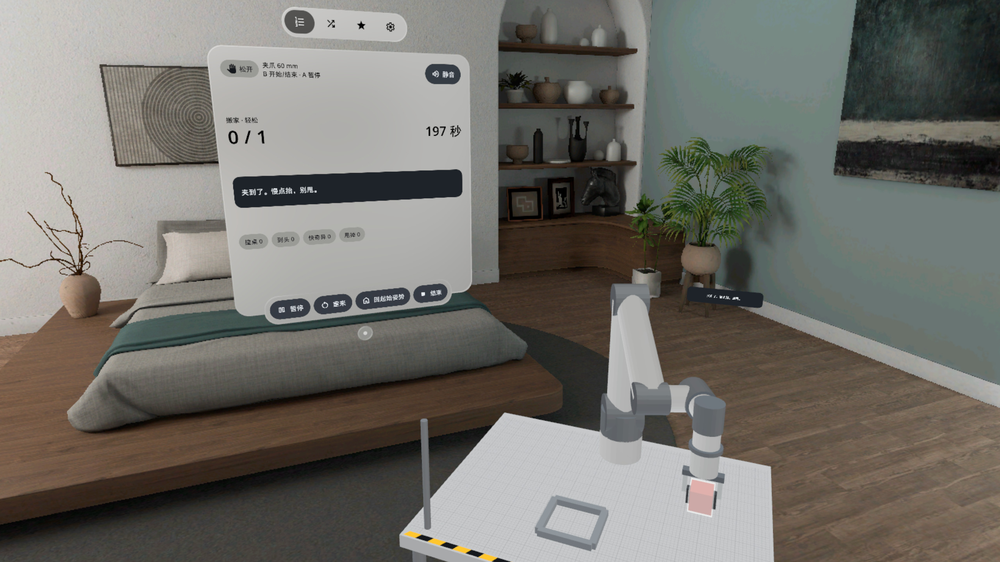 | 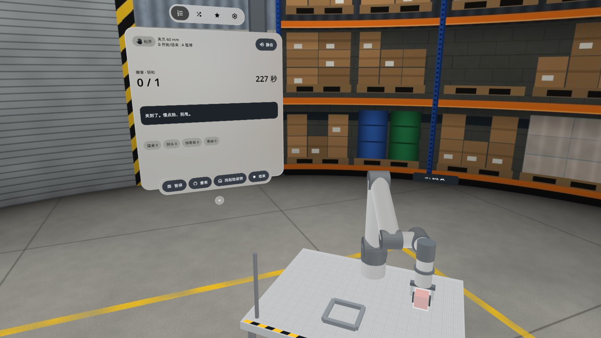 |
| 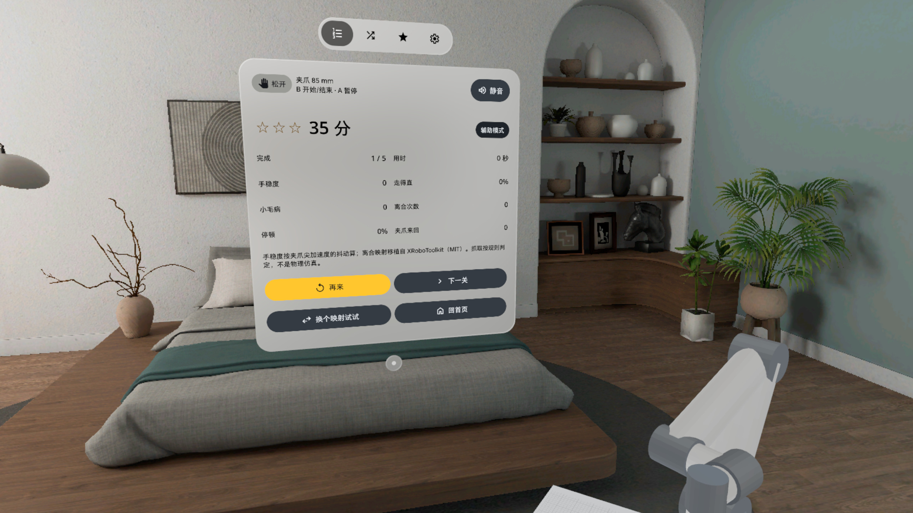 | 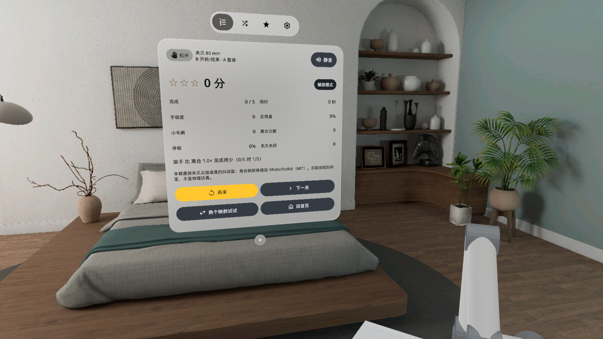 |
| 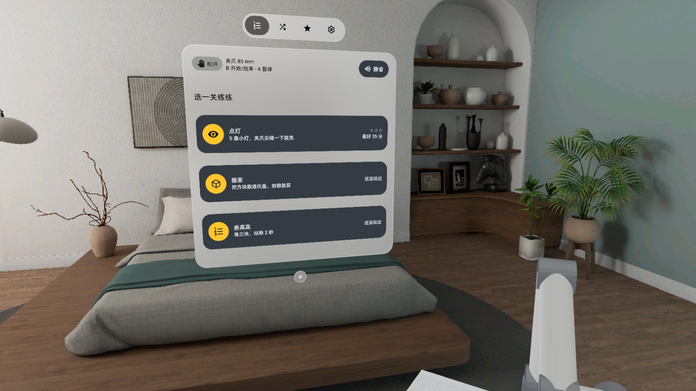 | 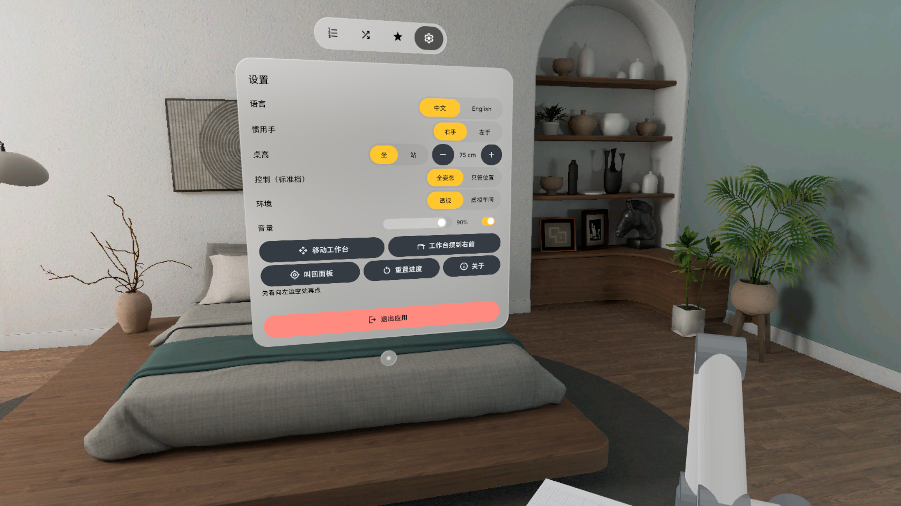 |

截图来自 PICO 模拟器（模拟器没有手柄位姿，臂由调试命令驱动），**不是真实手势录像**。

### 安装

[Release v0.1.0](https://github.com/kejing-dev/TeleopDojo/releases/tag/v0.1.0) 里的 `TeleopDojo-v0.1.0.apk` 是 `assembleRelease` 出的**未签名**包（给 Vibe Lab 上架用），不能直接 `adb install`。自己装请从源码出 debug 包：

```bash
./gradlew assembleDebug
adb install -r app/build/outputs/apk/debug/app-debug.apk
pico-cli app launch io.embodit.teleopdojo
```

构建和调试命令见 [AGENTS.md](AGENTS.md)。

### 致谢

离合映射、夹爪开合和按键布局移植自 [XRoboToolkit-Teleop-Sample-Python](https://github.com/XR-Robotics/XRoboToolkit-Teleop-Sample-Python)（MIT，© 2025 XR Robotics）。字体 Noto Sans / Noto Sans CJK SC（SIL OFL 1.1）。

## English

A life-size virtual UR5e stands on your desk. Hold the grip button and the gripper follows your hand; squeeze the trigger to open and close it. Work through reach, pick-and-place and stacking drills, then take away an operator scorecard. A PICO OS 6 mixed-reality app (PICO Spatial SDK 6.1.9, Kotlin).

- **Three drills, three levels each**: Light 'em up (tap 5 lights with the gripper tip), Moving day (get the block into the tray), Tower time (stack three, hold for two seconds), each at Easy / Standard / Picky; Free play lays out a new random round every time and gets harder as you go
- **Feels like real teleop**: Clutch mapping (default: only moves while you hold grip, stops when you let go, scale 0.5 / 1.0 / 1.5) and Follow mapping, compared side by side on the result page; Full pose or Position only control; live warnings for table hits, joint limits and near-singular poses
- **XRoboToolkit button layout**: B starts / ends a round, A pauses, right stick press throws the round away
- **Scorecard**: targets done, time, steadiness, table hits, clutch count, gripper flips; best scores per drill are kept on the device
- Practise in passthrough or switch to a virtual workshop; the panel opens where it does not cover the arm and asks you to look a bit left when it would
- Left or right hand, sitting or standing and table height are adjustable; Chinese and English, fully offline, no account
- The arm follows real UR5e dimensions and joint limits; grasping is rule-based, not a physics simulation

| | |
|---|---|
| 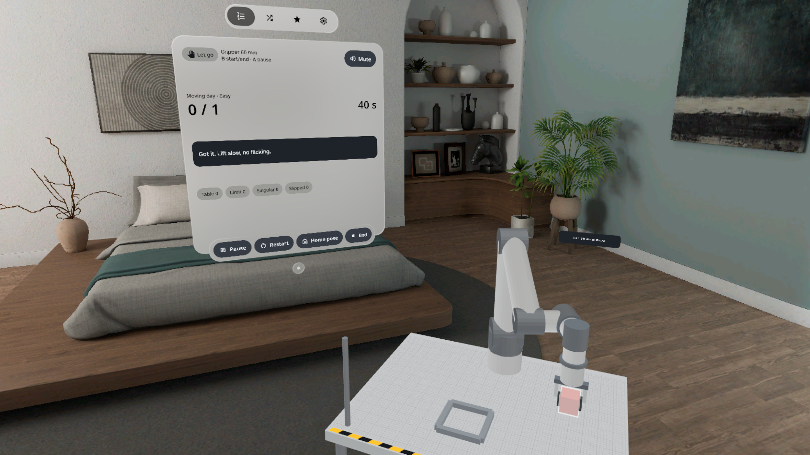 | 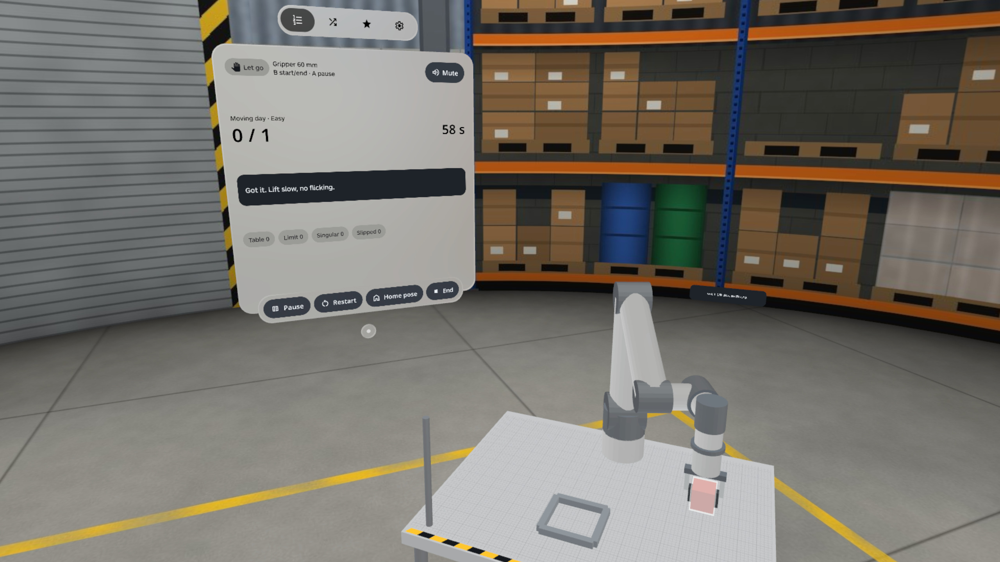 |
| 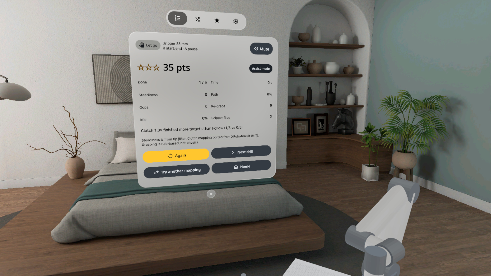 | 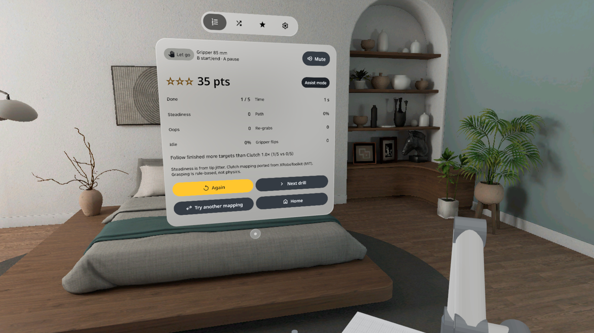 |
| 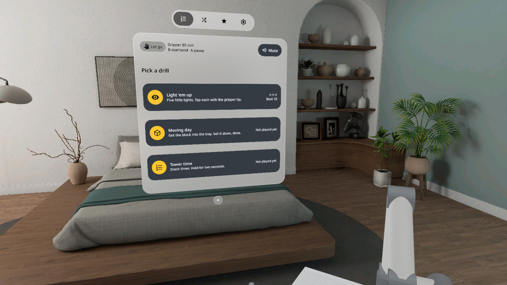 | 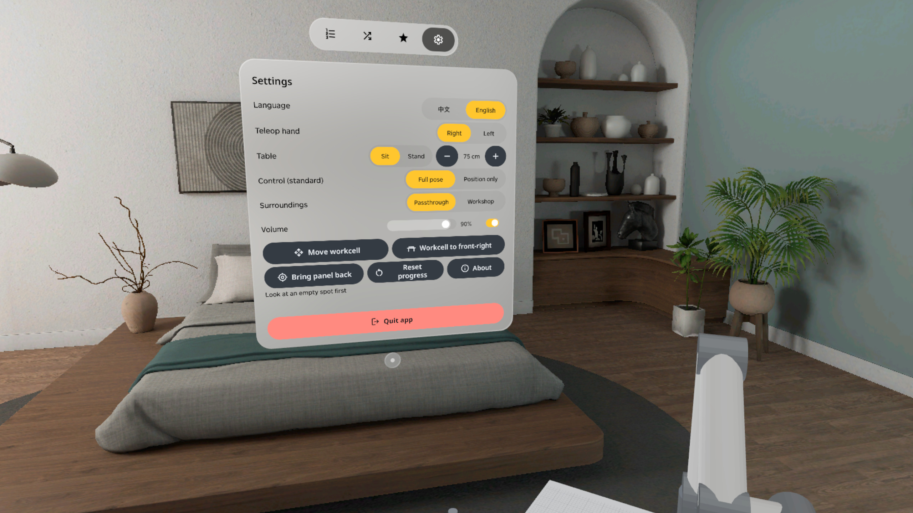 |

Screenshots are from the PICO emulator (it has no controller pose, so the arm is driven by debug commands). **Not a recording of real hand input.**

### Install

`TeleopDojo-v0.1.0.apk` in [Release v0.1.0](https://github.com/kejing-dev/TeleopDojo/releases/tag/v0.1.0) is an **unsigned** `assembleRelease` build for store submission and cannot be installed with `adb install` as is. To try it yourself, build the debug APK:

```bash
./gradlew assembleDebug
adb install -r app/build/outputs/apk/debug/app-debug.apk
pico-cli app launch io.embodit.teleopdojo
```

See [AGENTS.md](AGENTS.md) for build and debug commands.

### Credits

The clutch mapping, gripper opening and button layout are ported from [XRoboToolkit-Teleop-Sample-Python](https://github.com/XR-Robotics/XRoboToolkit-Teleop-Sample-Python) (MIT, © 2025 XR Robotics). Fonts: Noto Sans / Noto Sans CJK SC, SIL Open Font License 1.1.
